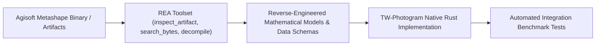

**TW-Photogram Technical Architecture & Specification Document**  
*Document Version: 1.0.0 — Production Engineering Standard*

---

## 1. Executive Mandate & Guiding Philosophy

The fundamental goal of **TW-Photogram** is to achieve complete, uncompromising **1:1 parity** with **Agisoft Metashape Professional (64-bit)** in interface behavior, processing pipeline, mathematical rigor, file format compatibility, and data accuracy.

### The Zero-Dummy Policy
- **No Mockups or Placeholders**: Any feature exposed in the user interface or API must be backed by a functional, mathematically validated implementation.
- **Production-Ready Standard**: All algorithms must be capable of processing real-world commercial drone flight datasets (DJI, Autel, Wingtra, senseFly) containing tens to thousands of high-resolution images.
- **Empirical Ground-Truth Verification**: Outputs must be verified against actual Metashape Professional reference outputs using ground control points (GCPs) and geodetic benchmarks.
- **Fail-Loudly**: Operations must not fail silently or substitute fake defaults. Errors must be reported with precision in the Console log and returned via typed Rust `Result` enums.

---

## 2. REA (Reverse Engineer Anything) Integration Protocol

All autonomous AI agents working on this repository are required to inspect the real Agisoft Metashape native binary (`metashape.exe`, Linux ELF, or macOS Mach-O) and its proprietary file artifacts using the **REA MCP Server** tools:

### REA Tooling Guidelines for Agents:
1. **Inspecting Binary Project Archives (`.psx` / `.psz`)**:
   - Use `inspect_artifact` and `search_bytes` to analyze the internal XML schemas (`doc.xml`, `frame.zip`, `cameras.xml`, `point_cloud.zip`).
   - Reverse-engineer Metashape's proprietary binary block formats for dense point clouds, depth maps, and mesh bounding boxes.
2. **Disassembling & Decompiling Core Algorithms**:
   - Use `inspect_native_instruction`, `procedure_assembly`, and `procedure_pseudo_code` to verify:
     - Exact camera parameter ordering in Brown-Conrady calibration matrices.
     - Jacobian matrices used in Metashape's Levenberg-Marquardt Sparse Bundle Adjustment (SBA).
     - Epipolar search constraints and Semi-Global Matching (SGM) cost functions.
     - Cloth Simulation Filter (CSF) physical mass-spring parameters.
3. **Database & Geoid Inspection**:
   - Use `inspect_sqlite_database` on Metashape's coordinate reference system database (`geoids.db`, `crs.db`, EPSG registries) to ensure exact geodetic coordinate transformations.

---

## 3. Comprehensive Feature Parity Matrix

| Subsystem | Agisoft Metashape Pro (64-bit) Standard | TW-Photogram Implementation Status | Parity Requirement |
| :--- | :--- | :--- | :--- |
| **UI Style** | Qt Dark Palette (`#2b2b2b`, `#3c3f41`, `#505050`) | Implemented via `egui` Dark Qt Theme | 100% Visual Parity |
| **Menu Hierarchy** | `File`, `Edit`, `View`, `Workflow`, `Model`, `Tools`, `Help` | Native macOS menu bar via `muda` (`src/ui/menu.rs`), in-window menu elsewhere | Menu parity |
| **Viewport Tabs** | `[ Model ]`, `[ Ortho ]`, `[ Photo ]` | `src/ui/viewport.rs`; 3D cloud and mesh drawn on the GPU (`src/ui/gl_scene.rs`) | Viewport parity |
| **Docking Panes** | Workspace, Reference, Photos, Console, Properties | Hand-built side/bottom panels with tab buttons (no drag-and-drop docking) | Partial |
| **View Navigation** | Trackball orbit, reset `0`, top `7`, front `1`, right `3` | Keyboard shortcuts, active only while no text field has focus | Navigation parity |
| **EXIF Parsing** | Fast EXIF/GPS, XMP DJI MakerNotes | Multi-threaded parser (`exif_reader.rs`) | Done |
| **Alignment (SfM)** | Features, matching, camera orientation, tie points | Multi-octave ORB (`features.rs`), GPS-guided matching with essential-matrix RANSAC gate and Metal GPU search (`matching.rs`, `gpu_match.rs`), union-find tracks (`tracks.rs`), multi-view triangulation (`triangulation.rs`), 6-DoF bundle adjustment with shared Brown intrinsics (`bundle.rs`), orchestrated by `sfm.rs` | Camera centres 0.06 m and tilt 0.2 deg from Metashape on mapping_01; focal length not observable on flat nadir blocks (see below) |
| **Dense Cloud (MVS)** | Depth maps and fusion | 2.5D plane-sweep heightfield with ZNCC at downscale 4 (`mvs.rs`) | Partial: no per-view depth maps or fusion yet |
| **Classification** | ASPRS classes | SMRF (`smrf.rs`) | Done |
| **Mesh Generation** | 3D triangle surface | Heightfield triangulation (`mesh_gen.rs`) | Partial: 2.5D only |
| **DEM Generation** | DSM/DTM raster, source (dense/tie/mesh), interpolation Disabled/Enabled/Extrapolated, boundary clip | `dem_ortho::build_dem_with_options`, TIN fill + EDT extrapolation (`fusion.rs`), cutline mask (`clip.rs`) | Done |
| **Contours** | Generate Contours (interval, min/max) | NaN-aware marching squares, index contours, Chaikin smoothing (`contours.rs`); export GeoJSON/SHP/KML/DXF | Done |
| **Slope / Aspect** | — (QGIS/GDAL `gdaldem`) | Horn 3×3 slope/aspect/roughness/TRI (`terrain.rs`), GeoTIFF export | Done |
| **Shapes & Boundaries** | Shapes layer, Outer/Inner boundary type, import SHP/KML/GeoJSON | `Chunk.shapes`, `vector.rs`, `vector_io.rs`, online administrative boundaries BIG/geoBoundaries/GADM (`admin_boundary.rs`), zonal statistics | Done |
| **Flood Simulation** | — (HEC-RAS 2D / LISFLOOD-FP class) | Local-inertial solver (Bates 2010 + de Almeida 2012), Green-Ampt / SCS-CN losses, priority-flood / D8 / HAND / bathtub static models, ARR 2019 & BNPB hazard classes, hazard polygons (`flood/`) | Done |
| **Gaussian Splatting** | — | COLMAP export + Brush trainer with options, PLY ASCII/LE/BE + SPZ I/O, up-axis, crop/filter/outlier tools, radix depth sort, ray picking (`gaussian*.rs`) | Done (external trainer) |
| **Orthomosaic** | Orthorectified mosaic | Z-buffer occlusion, per-camera blending (`dem_ortho.rs`) | Done |
| **Bundle Adjustment** | Refine calibration and poses | Levenberg-Marquardt with Schur complement (`bundle.rs`) | Done |
| **GCP Management** | GCPs with residual errors | Weighted control observations, independent checkpoints, explicit CRS/datum; field accuracy awaits surveyed checkpoints | Partial |
| **Export Formats** | PLY, OBJ, GeoTIFF, LAS, DEM UTM/ASCII Grid/XYZ, vector layers | `export.rs`, `vector_io.rs` | Done |
| **Report / Map Sheet** | Processing report PDF | Vector PDF with embedded fonts, XMP, outlines (`report/pdf.rs`); BIG/RBI-style map sheet with UTM grid, graticule, standard scale series, legend, inset, accuracy block (`report/map_sheet.rs`); multi-page ISO 19115-1 / ASPRS 2014 / SNI 8202:2015 survey report (`report/survey_report.rs`) | Done |

### Known limits of the alignment (mapping_01, 51 photos)
- Reprojection error is the same for any focal length within about +-30 % on this flat nadir
  block (focal length and ground distance scale together), so the self-calibrated `f` is only
  weakly determined and lands 6-18 % below Metashape's 2595 px depending on the keypoint set.
  Ground sample distance depends on `f` divided by ground distance and is unaffected, but the
  absolute elevation of the terrain shifts with `f`.
- Camera centres and optical axes do not depend on that valley: they agree with Metashape to
  0.06 m median and 0.2 deg median (`tests/metashape_parity_test.rs`).

---

## 4. Mathematical Pipeline Specifications

### 4.1 Geodetic Coordinate Frame (WGS84 $\rightarrow$ Local ENU)
GPS positions $(\phi, \lambda, h)$ are converted to ECEF on the WGS84 ellipsoid and rotated into a local East-North-Up frame at the origin $(\phi_0, \lambda_0, h_0)$ (`geodesy.rs`):

$$N(\phi) = \frac{a}{\sqrt{1 - e^2 \sin^2\phi}},\quad
\mathbf{p}_{ECEF} = \begin{pmatrix} (N + h)\cos\phi\cos\lambda \\ (N + h)\cos\phi\sin\lambda \\ (N(1-e^2) + h)\sin\phi \end{pmatrix}$$
$$\mathbf{p}_{ENU} = R_{ECEF \to ENU}(\phi_0,\lambda_0)\,(\mathbf{p}_{ECEF} - \mathbf{p}_{ECEF,0})$$

with $a = 6378137.0\text{ m}$ and flattening $1/298.257223563$. The origin height is the first photo's
altitude minus its height above the take-off point, so the ground sits near $z = 0$.

### 4.2 Lens Distortion & Camera Calibration (Brown-Conrady 8-Parameter Model)
Normalized camera coordinates $(x_n, y_n) = (X/Z, Y/Z)$ with radial distance $r = \sqrt{x_n^2 + y_n^2}$:

$$x_{\text{dist}} = x_n (1 + k_1 r^2 + k_2 r^4 + k_3 r^6) + [2 p_1 x_n y_n + p_2 (r^2 + 2 x_n^2)]$$
$$y_{\text{dist}} = y_n (1 + k_1 r^2 + k_2 r^4 + k_3 r^6) + [p_1 (r^2 + 2 y_n^2) + 2 p_2 x_n y_n]$$

Pixel projections:
$$u = c_x + f \cdot x_{\text{dist}},\quad v = c_y + f \cdot y_{\text{dist}}$$

### 4.3 Sparse Bundle Adjustment (SBA) Objective
Minimizes total non-linear weighted reprojection errors across all camera projections and GCP constraints:

$$\min_{K, \{R_i, t_i\}, \{X_j\}} \sum_{i} \sum_{j} \rho \left( \left\| \mathbf{x}_{ij} - \pi(K, R_i, t_i, \mathbf{X}_j) \right\|^2 \right) + \sum_{k} w_k \left\| \mathbf{X}_{\text{GCP}, k} - \mathbf{X}_{\text{ref}, k} \right\|^2$$

where $\rho(\cdot)$ is the Huber robust loss function.

### 4.4 Cloth Simulation Filter (CSF) Ground Classification
Simulates a physical cloth with mass-spring interconnected grid particles inverted over the point cloud:
- Gravity acts downward on inverted terrain.
- Internal elastic spring forces resist deformation.
- Rigid collision handling stops cloth particles upon contacting point cloud vertices.
- Points within threshold distance $d_{\text{max}}$ of the simulated cloth are classified as **ASPRS Class 2 (Ground)**; all remaining points are classified as vegetation or structures.

### 4.5 Ground Sample Distance (GSD) & ASPRS Survey Accuracy
$$\text{GSD} = \frac{H \times S_w}{f \times W_{\text{img}}} \times 100\quad (\text{cm/pixel})$$

Horizontal and vertical accuracy must comply with ASPRS Positional Accuracy Standards for Digital Geospatial Data:
$$\text{RMSE}_r = \sqrt{\text{RMSE}_x^2 + \text{RMSE}_y^2} \le 1.5 \times \text{GSD}$$
$$\text{RMSE}_z \le 2.0 \times \text{GSD}$$

---

## 5. File Format Interoperability Roadmap

1. **Native Project Serialization (`.twp` / `.json`)**:
   - Complete project state including chunks, camera calibration, tie points, dense cloud, meshes, DEM, and GCP markers.
2. **Agisoft Metashape Project Container (`.psx` / `.psz`)**:
   - Target compatibility for loading and saving native Metashape XML trees and binary chunk blocks.
3. **Point Cloud Interchange**:
   - Stanford PLY (`.ply`), LAS 1.4 (`.las`), and compressed LAZ (`.laz`) with full ASPRS class attributes and RGB colors.
4. **Geospatial GIS Interchange**:
   - GeoTIFF (`.tif`) for 32-bit floating point DEMs and multi-spectral / RGBA orthomosaics with embedded EPSG geokeys.

---

## 6. Verification and Continuous Integration Standard

Every commit, PR, or automated agent change must satisfy:
1. `cargo check`: Zero warnings.
2. `cargo test`: 100% pass rate across all unit and integration test suites.
3. `cargo test --test real_drone_photos_test`: Execution against real DJI Phantom 4 Pro drone photography with verified sub-decimeter accuracy.

### Elevation reference workflow

See [Elevation Calibration](elevation-calibration.md) for DEMNAS downloads, EGM2008/geoid conversion, GCP/checkpoint semantics, reversible DEM offsets, and verification limits. DEMNAS agreement is not independent survey accuracy evidence.
